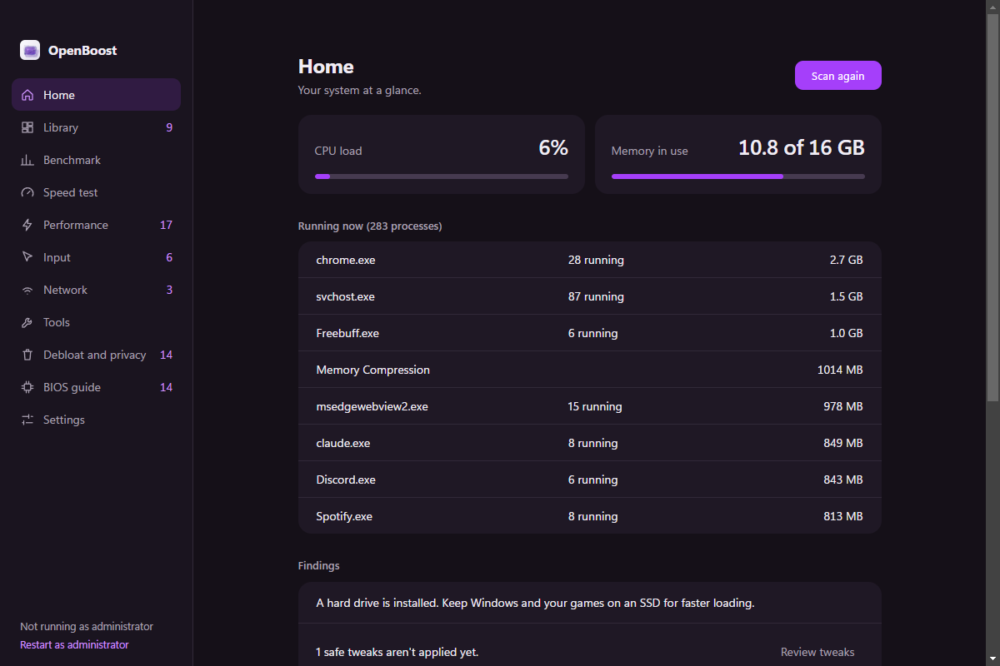
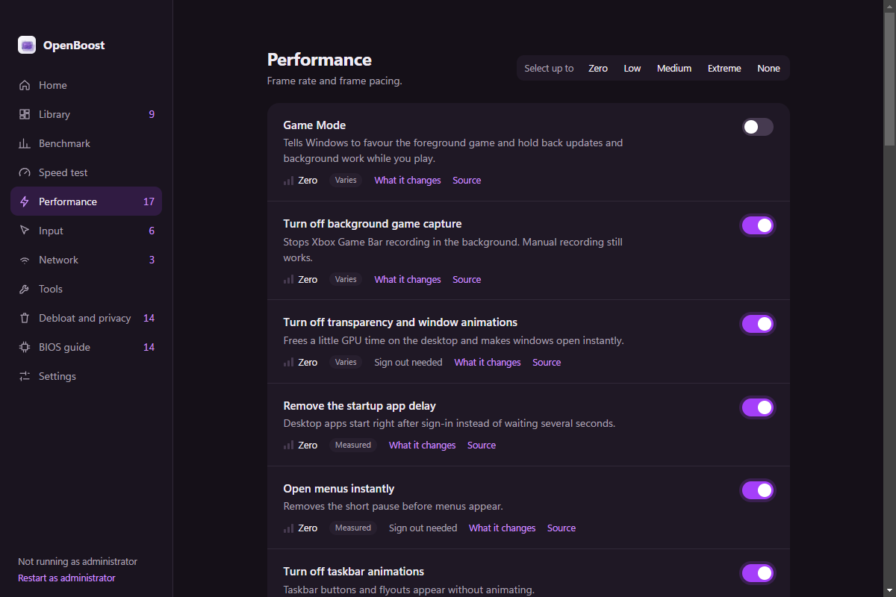
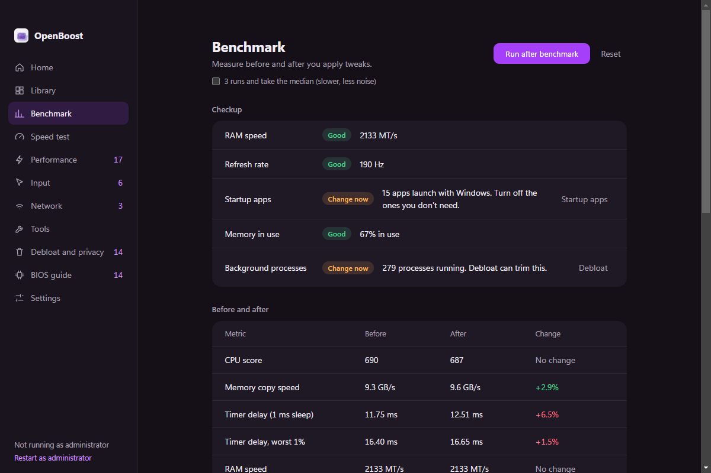
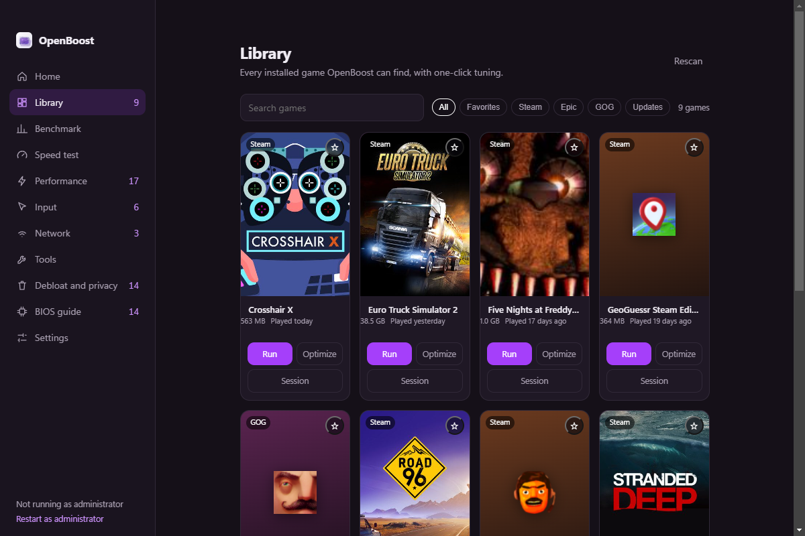

# OpenBoost

**Windows tuning, with receipts.**

OpenBoost is a Windows 10/11 utility for performance, input, network and debloat tweaks. It shows the exact registry, service or power-plan change before applying it, saves the original value first, and lets you undo it later. It also includes benchmarks, a game library, a desktop overlay and diagnostics.

<p align="center">
  
</p>

<p align="center">
  <a href="https://www.axy.is-cool.dev/openboost/"></a>
  
  
  <a href="LICENSE.md"></a>
  
</p>

<p align="center">
  <a href="https://www.axy.is-cool.dev/openboost/">Website</a> ·
  <a href="https://github.com/ExbotsSites/OpenBoost/releases/latest">Download</a> ·
  <a href="https://github.com/ExbotsSites/OpenBoost/issues">Issues</a> ·
  <a href="#quick-start">Build from source</a> ·
  <a href="LICENSE.md">License</a>
</p>

> **AI disclosure:** This project was made with AI.

OpenBoost is **source-available**, not open source. You can inspect the code and use official builds for personal, non-commercial purposes, but reuse, redistribution, resale and commercial use require the owner's prior written acceptance. See [LICENSE.md](LICENSE.md).

---

## Contents

- [What it does](#what-it-does)
- [Screenshots](#screenshots)
- [Safety model](#safety-model)
- [Install](#install)
- [Quick start](#quick-start)
- [Build a release](#build-a-release)
- [Project structure](#project-structure)
- [How it works](#how-it-works)
- [Data and privacy](#data-and-privacy)
- [Make it yours](#make-it-yours)
- [Testing and CI](#testing-and-ci)
- [Troubleshooting](#troubleshooting)
- [Contributing](#contributing)
- [License](#license)
- [AI disclosure](#ai-disclosure)
- [Credits](#credits)

---

## What it does

### Tweaks with receipts

- **Performance**, **Input**, **Network** and **Debloat and privacy** categories.
- Each row shows its risk level, expected impact, the Windows build it needs and a link to Microsoft documentation.
- **Preview** lists every value as `before → after` before anything is written.
- **Apply** saves the original value first, then makes the change.
- **Undo** restores the saved value, not a guessed default.
- **Drift detection** notices when something changed outside OpenBoost and asks what to do before an undo.
- **Anti-cheat warning** checks for Vanguard, Easy Anti-Cheat, BattlEye and FACEIT before applying tweaks that may interact with them.

### Measure it

- Before/after benchmark with an optional **three-run median**.
- Reports which tweaks changed between runs, plus RAM speed, refresh rate, startup apps and process counts.
- **Bufferbloat** test measures added latency while four download streams saturate the connection.
- **Speed test** finds the nearest LibreSpeed server, or lets you pick one by city or country.

### Games and system tools

- **Library** scans Steam, Epic and GOG for installed games, covers, install size, last played and update state.
- Per-game **Optimize** and **Session mode**: apply game tweaks, launch the game, watch the process, then restore when it closes.
- **Live overlay** shows CPU, memory and GPU load; `Ctrl+Alt+O` toggles it.
- **Disk cleanup** for temp files, caches, Windows Update downloads, crash dumps and the Recycle Bin, with protected folders respected.
- **System Restore** points and a **graphics/driver** helper.
- **Diagnostics** export a JSON snapshot with your account name redacted, or open a prefilled GitHub issue.

### Make it yours

- Dark, Midnight and Light themes.
- Any accent color; the neutral palette is derived from it.
- English, Italian, Spanish, French and German interface translations.
- A 1200×630 benchmark share card in Midnight, Paper or Accent style.

---

## Screenshots

| Tweaks | Benchmark |
| --- | --- |
|  |  |

| Library | Home |
| --- | --- |
|  |  |

These are real captures from the app, not mockups.

---

## Safety model

OpenBoost is deliberately conservative for a tweaking tool:

- **Backups first.** Every reversible tweak stores its previous registry value, service start type or power plan in `state.json` before changing anything.
- **Atomic state writes.** Backups are written to a temporary file and renamed, with a `.bak` copy, so a crash during a write does not destroy the undo data.
- **Preview.** The Preview button shows every change. Nothing is written until Apply.
- **Drift detection.** If a saved value changed outside OpenBoost, Undo asks whether to keep the outside change or restore the backup.
- **Restore point.** The pending-changes bar can create a Windows System Restore point before applying a batch. Windows may skip it if another point was created in the last 24 hours.
- **Risk labels.** Risk 1 is Zero, 2 is Low, 3 is Medium and 4 is Extreme. Extreme changes need an extra confirmation.
- **Anti-cheat check.** Tweaks that can interact with kernel anti-cheat are checked before they run.
- **App removal is the exception.** Removing preinstalled Store apps cannot be undone by OpenBoost; reinstall them from the Microsoft Store. The app marks those actions as irreversible.
- **Protected folders.** Disk cleanup skips Documents, Desktop, Downloads, Pictures, Music, Videos, Saved Games and folders you add in Tools.
- **No hidden telemetry.** Diagnostics are exported only when you click the button, and the Windows account name is replaced with `%USERPROFILE%`.

The app only changes Windows settings. It does not download or install GPU drivers, bypass anti-cheat, or promise a fixed FPS gain. If a tweak is placebo or varies by machine, the README for that tweak should say so.

---

## Install

### Download

Get the latest build from [Releases](https://github.com/ExbotsSites/OpenBoost/releases/latest).

- **Installer** — `OpenBoost-1.0.0-setup.exe`; adds Start-menu and desktop shortcuts plus an uninstall entry.
- **Portable** — `OpenBoost-1.0.0-portable.exe`; runs from any folder. Settings and backups still use Electron's normal user data folder unless you manage that folder yourself.

Requirements: **Windows 10 or 11, 64-bit**. Some tweaks need administrator rights; the app marks those and offers **Restart as administrator**.

Builds are **unsigned**, so SmartScreen may warn you. If the release page publishes a SHA-256, compare it before running the installer.

### First run

1. Open **Home** and run **Scan system**.
2. Create a restore point from **Tools** before a large batch.
3. Run a **before** benchmark if you care about measuring the result.
4. Review a tweak's **What it changes** and **Source** before enabling it.
5. Apply a small batch, then run the **after** benchmark.

Uninstalling OpenBoost does not undo tweaks. Use **Settings → Undo tweaks** before uninstalling if you want the saved originals restored.

---

## Quick start

### Requirements

- Windows 10 or 11 for the supported app
- **Node.js 20+**
- npm
- An administrator terminal for tweaks that write to HKLM or change services

The app uses **Electron 28**, vanilla HTML/CSS/JavaScript and Electron Builder. There is no framework, bundler or API key.

### Run the development build

```bash
git clone https://github.com/ExbotsSites/OpenBoost.git
cd OpenBoost
npm install
npm start
```

Run the terminal as administrator if you want to test system-level tweaks. The app can also relaunch itself elevated from the **Not running as administrator** button.

### Validate before changing code

```bash
npm test
```

This checks every tweak definition and its `tweak-meta.js` entry. It is the same test the GitHub Actions workflow runs.

---

## Build a release

```bash
npm install
npm run build
```

`npm run build` runs:

1. `npm run make-icons` — regenerates `build/icon.ico`, `build/icon.png` and the in-app icons from `icon.jpg`.
2. `electron-builder` — packages the Windows installer and portable executable.

Expected output in `dist/`:

| Artifact | Description |
| --- | --- |
| `OpenBoost-1.0.0-setup.exe` | NSIS installer with shortcuts and an uninstall entry |
| `OpenBoost-1.0.0-portable.exe` | Portable executable that runs from any folder |

### Build notes

- Build from an administrator terminal, or enable Windows **Developer Mode**, or electron-builder may fail with a symbolic-link error.
- `icon.jpg` should be square and at least 512×512.
- `build/` contains the generated icons; `dist/` contains the release output.
- Builds are **not code-signed**. Add signing credentials before distributing broadly.
- The package config also contains macOS and Linux icon settings, but Windows is the supported release target.
- There is no built-in app updater. Publish a new release when the version changes.

---

## Project structure

```text
OpenBoost/
├── main.js                 Electron entry point and IPC registration
├── preload.js              contextBridge API exposed as window.openboost
├── engine.js               Apply, preview, restore, drift detection and history
├── tweaks.js               Tweak definitions and Windows actions
├── tweak-meta.js           Impact level and Microsoft documentation search terms
├── safety.js               Anti-cheat checks, restore points and diagnostics
├── settings.js             Persistent settings and validation
├── bench.js                Before/after benchmark
├── speed.js                LibreSpeed and bufferbloat tests
├── dns.js                  DNS Jumper download and launch
├── games.js                Steam, Epic and GOG library scanning
├── tools.js                Disk cleanup, graphics info and external links
├── overlay.js              Always-on-top performance overlay
├── overlay-preload.js      Overlay window IPC bridge
├── renderer/
│   ├── index.html          App shell
│   ├── renderer.js         Navigation, tweak rows, benchmark and BIOS pages
│   ├── i18n.js             Interface translations
│   ├── theme.js            Accent-derived palette and theme modes
│   ├── card.js             Benchmark share card
│   ├── extras.js           Tools, settings and overlay UI
│   ├── library.js          Game library UI
│   ├── modal.js            Modal helper
│   ├── styles.css          App styles
│   └── icon.png            In-app icon
├── site/openboost/         Public project page and screenshots
├── tools/
│   ├── check-tweaks.js     npm test validator
│   └── make-icons.js       Generates build and app icons
├── build/                  Generated installer icons
├── .github/workflows/ci.yml
├── package.json
└── LICENSE.md
```

---

## How it works

### Electron split

`main.js` owns the window, IPC handlers and privileged work. The renderer runs with `contextIsolation: true`, `nodeIntegration: false` and `sandbox: true`. `preload.js` exposes a small API as `window.openboost`:

```js
await openboost.list();
await openboost.preview({ apply, revert });
await openboost.apply({ apply, revert, release, restorePoint });
await openboost.revertAll();
```

Renderer code never gets direct Node or `ipcRenderer` access.

### Applying a tweak

1. `engine.list()` reads installed Windows state, the saved `state.json` and the tweak definitions.
2. `engine.preview()` computes a `before → after` diff for the pending selection.
3. `engine.apply()` saves every original value first, then writes registry values, changes service start types, activates a power plan or removes Appx packages.
4. `engine.revertAll()` reads the saved originals and restores them. Power plans that OpenBoost created are deleted.
5. `history.json` keeps the last 100 apply/undo batches.

A tweak is a `T(...)` entry in `tweaks.js` with one or more actions:

```js
T('example-id', 'performance', 1, 'Example tweak', 'What this changes.', [
  dw('HKCU\\Software\\Example', 'Enabled', 1)
])
```

Actions can be registry values (`reg`), service changes (`service`), a power plan (`power`) or Appx removal (`appx`). The engine detects admin-only actions from their targets; the UI disables them until the app is elevated.

### Renderer

The sidebar and pages are driven by `CATS` in `renderer.js`. `PAGES` maps special pages (`home`, `bench`, `speed`, `bios`) to render functions. The pending bar collects changes until you press **Apply**.

### Overlay and benchmark

The overlay is a separate always-on-top `BrowserWindow`; `overlay.js` owns it and `overlay-preload.js` supplies its IPC. The benchmark in `bench.js` measures CPU, memory, timer resolution, p99 frame time, processes and startup apps; `main.js` stores the before/after results in `bench.json`.

### Network features

- **Speed test** uses LibreSpeed's public server list and Cloudflare for bufferbloat.
- **DNS Jumper** downloads a third-party zip from sordum.org, extracts it to a temporary folder and opens it; the hash and Authenticode status are shown.
- **Documentation** links are restricted to `learn.microsoft.com`.
- No account, cloud sync or remote backend is involved.

---

## Data and privacy

Electron stores app data in its `userData` directory, normally `%APPDATA%\OpenBoost` on Windows.

| File | Purpose |
| --- | --- |
| `state.json` | Saved original values for every applied tweak |
| `state.json.bak` | Backup copy of the state file |
| `history.json` | Last 100 apply/undo batches |
| `settings.json` | Theme, accent, language, overlay options and protected folders |
| `bench.json` | Before/after benchmark results |
| `games.json` | Cached game library and preferences |
| `window.json` | Window size and position |
| `thumbnails/` | Cached game cover images |

The renderer also uses `localStorage` for the last page, benchmark run count, speed-test history and a few UI preferences.

**Local by default.** OpenBoost does not add analytics or a telemetry service. The diagnostics export is manual and redacts your Windows account name. Network access happens only for features you invoke: speed tests, the DNS tool, documentation links, GitHub issue/release links and game cover lookups.

To reset app state, close OpenBoost and remove the user data folder. To reset tweaks safely first, use **Settings → Undo tweaks**. Removing the data folder without undoing changes leaves those Windows settings in place.

---

## Make it yours

### Change the name, version or bundle identity

Edit `package.json`:

```json
{
  "name": "openboost",
  "version": "1.0.0",
  "productName": "OpenBoost",
  "build": {
    "appId": "org.openboost.app",
    "productName": "OpenBoost"
  }
}
```

Also update:

- the `<title>` and visible brand in `renderer/index.html`
- the window title in `main.js`
- the installer names in `package.json` if you want a different release scheme
- `icon.jpg`, then run `npm run make-icons`

### Change the theme

`renderer/theme.js` is the source of truth:

- `ACCENTS` contains the preset accent colors.
- `palette(accent, mode)` derives the background, rail, surfaces, text, muted text, links and code colors.
- `applyTheme()` writes CSS variables such as `--bg`, `--rail`, `--raise`, `--text`, `--mute` and `--accent`.
- The `dark`, `midnight` and `light` branches control the three modes.

To add a preset, add a hex color to `ACCENTS`. To change the default, update `DEFAULTS.accent` in `settings.js` and the fallback in `theme.js`. Layout and component styles live in `renderer/styles.css`.

### Add a tweak

1. Add a definition to `tweaks.js`:

   ```js
   T('example-id', 'performance', 1, 'Example tweak',
     'A short, honest description of what changes.',
     [dw('HKCU\\Software\\Example', 'Enabled', 1)])
   ```

2. Add metadata for the same id to `tweak-meta.js`:

   ```js
   META['example-id'] = {
     impact: 1,
     terms: 'site:learn.microsoft.com example setting'
   };
   ```

3. Run `npm test`.

Rules enforced by the validator:

- `id` must be unique, lowercase kebab-case.
- `cat` must be `performance`, `input`, `network` or `debloat`.
- `risk` must be 1–4.
- Name ≤ 80 characters; description ≤ 280 characters.
- Every action must be valid; registry keys must start with `HKCU\` or `HKLM\`.
- Every tweak needs a `META` entry with `impact` and `terms`.
- Only Appx removal may be marked `reversible: false`.

If an action writes to HKLM or changes a service, mark the tweak so the UI requires administrator rights. The engine detects most of this from the action targets.

### Add a page

1. Add an entry to `CATS` in `renderer/renderer.js` with an id, label, note and SVG icon.
2. Add a render function and register it in `PAGES` if it needs a full page instead of a tweak list.
3. Use the existing `#home` container and `render()` pattern so the sidebar, heading and pending bar stay consistent.
4. Add `nav.<id>` and `note.<id>` keys to every language in `renderer/i18n.js`.
5. Add the page to the sidebar translation fallback if the key is missing.

The renderer shell is intentionally small: `renderer/index.html` contains the frame, and each page builds its markup in JavaScript.

### Add a language

1. Copy the `en` block in `renderer/i18n.js`.
2. Translate the keys and add the language code to `LANG_NAMES`.
3. Add the code to `LANGS` in `settings.js`.
4. Leave missing keys out; the app falls back to English.

Tweak descriptions and long explanations are currently English-only. The translated interface covers navigation, buttons, settings and the newer tools.

### Change benchmark, speed test or overlay behavior

- Benchmark metrics: `bench.js`; storage and IPC: `main.js`.
- Speed test and bufferbloat: `speed.js`; server lookup and UI in `renderer.js`.
- Overlay layout: `renderer/overlay.html` and `renderer/overlay.css`; window and hotkey: `overlay.js` and `main.js`.
- Overlay defaults: `settings.js` under `overlay`.

### Change the build

`package.json` controls:

- `build.appId`, `build.productName`
- `build.directories.output` (`dist`)
- Windows NSIS and portable targets
- installer icon and shortcut names
- generated artifact names
- macOS/Linux icon paths

Add code signing before a public release if you want to avoid SmartScreen warnings.

---

## Testing and CI

```bash
npm test
```

The test checks every tweak and metadata entry. It fails on malformed ids, unknown categories, invalid registry actions, missing metadata, duplicate ids and unsupported irreversible flags.

The GitHub Actions workflow in `.github/workflows/ci.yml` runs on Windows with Node 20:

- `npm ci` (or `npm install` if there is no lockfile)
- `npm test`
- `node --check` on every app, renderer and tool script

There is no automated UI test suite. Before a pull request, manually check the affected flow:

- scan and tweak list load
- a tweak previews and applies
- undo restores the original value
- benchmark before/after
- game library scan and launch
- overlay hotkey
- settings, theme and language
- `npm run build` if packaging changed

---

## Troubleshooting

| Problem | Fix |
| --- | --- |
| Tweak is disabled and says it needs administrator | Close OpenBoost and run it from an administrator terminal, or use **Restart as administrator**. HKLM and service changes need elevation. |
| `npm test` fails with a missing metadata entry | Add the same id to `META` in `tweak-meta.js` with `impact` and `terms`. |
| `npm test` fails on a registry action | Use `HKCU\` or `HKLM\`, a non-empty value name, and `REG_DWORD` or `REG_SZ` with valid data. |
| Build fails with a symbolic-link error | Run the build from an administrator terminal or enable Windows Developer Mode. |
| SmartScreen warns about the installer | Builds are unsigned. Verify the SHA-256 if the release publishes one, or build locally. |
| A removed app cannot be restored | Appx removal is irreversible in OpenBoost. Reinstall the app from the Microsoft Store. |
| Undo asks about a change made outside OpenBoost | **Keep current** forgets the saved original; **Restore original** puts the backup back. Choose deliberately. |
| Overlay does not appear over a game | It works over windowed and borderless games. Exclusive fullscreen hides it. |
| Speed test cannot reach a server | Check your connection, clear the server search, or choose another LibreSpeed server. |
| DNS tool fails | It needs access to sordum.org and may be blocked by a proxy or antivirus. |
| Settings or backups cannot be written | The user data folder is read-only or blocked. Check permissions and available disk space. |

---

## Contributing

Small, focused pull requests are welcome.

- Keep changes reversible unless they are Appx removal; if a tweak is not reversible, explain why.
- Add a Microsoft documentation source or a benchmark for new tweaks.
- Run `npm test` before opening the PR.
- Test the affected UI manually; there is no UI test suite.
- Do not commit `dist/`, generated icons, user data, diagnostics or secrets.
- By submitting a contribution, you agree to the contribution terms in [LICENSE.md](LICENSE.md). You retain copyright and grant the owner the rights needed to include and distribute the change.

OpenBoost is source-available for transparency and personal use. It is not an open-source project, and the license does not permit copying, redistributing, reselling or commercial use without the owner's prior written acceptance.

---

## License

OpenBoost is licensed under the **OpenBoost Source-Available License**. See [LICENSE.md](LICENSE.md).

In short:

- **Allowed:** personal, non-commercial use of official builds; viewing the source; a personal source build that is not distributed; forks solely to submit a contribution.
- **Not allowed without prior written acceptance:** copying, publishing, redistributing, reusing in another product, reselling, sublicensing, bundling or commercial use.

For permission, open an issue at [github.com/ExbotsSites/OpenBoost](https://github.com/ExbotsSites/OpenBoost) or contact the owner through the repository.

---

## AI disclosure

**This project was made with AI.**

AI was used to help write and review the code, documentation and interface. It does not make the app's Windows changes safe by itself: review the preview, keep backups, and test on your own machine.

---

## Credits

- [Electron](https://www.electronjs.org/) and [electron-builder](https://www.electron.build/)
- [sharp](https://sharp.pixelplumbing.com/) and [png-to-ico](https://github.com/steambap/png-to-ico) for icon generation
- [LibreSpeed](https://librespeed.org/) for the public speed-test network
- Microsoft Learn for the tweak documentation links
- sordum.org for the optional DNS Jumper tool
- Built by [Axyy](https://github.com/ExbotsSites)
